<div align="center">


<p>
  
  
  
  
  
</p>

### Claude Code, with a dashboard, a safety net and a memory.

carapace is a shell you put around Claude Code. One install gives it a plain checklist of what Claude is doing,<br>
helpers that split big jobs, guards that keep secrets and fake packages out, memory between sessions,<br>
and a report of the hours it saved you. One command removes all of it.

**Beta:** expect rough edges. When something breaks, **⚑ Problem** on the bar sends a report straight to us.

[Install](#install-in-one-command) · [First run](#first-run-a-few-questions) · [What you get](#what-you-get) · [Look](#make-it-yours) · [Commands](#commands) · [Privacy](#what-stays-on-your-computer) · [FAQ](#questions) · [Contribute](#contributing)

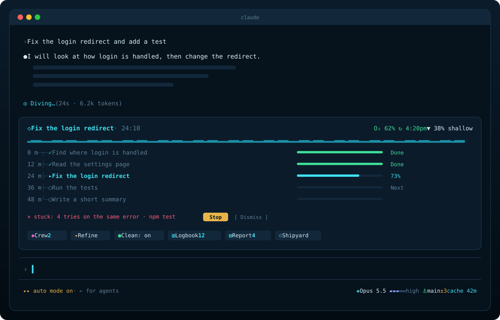

</div>


## Why carapace

Claude Code is powerful, and it shows you everything: every file read, every command, every line of output. That is great when you want it, and a wall of text when you only want to know if the job is going well. carapace sits around Claude Code and adds what it does not have yet:

| You want to | carapace gives you |
| --- | --- |
| See what Claude is doing at a glance | **Clean View**: a checklist of plain-English steps, how full the chat is, and how much of your plan is left |
| Get big jobs done faster | **Crew**: helpers that split the work, each on the cheapest model that can do its part |
| Ask better | **Refine**: turns a rough prompt into a clear one before you send it |
| Keep secrets secret | **Secret guard**: `.env` files and keys never reach the chat |
| Avoid fake or risky packages | **Package guard**: checks every package before it is installed |
| Spend fewer tokens | **Trimmer**: long test and build logs are cut to what matters |
| Pick up where you left off | **Logbook**: your work's memory in an Obsidian vault, read at every session start |
| Know what it is worth | **Work Report**: tasks done, hours saved and their value at your hourly rate |

It all runs inside Claude Code itself. There is no separate app, no account and no server.


## Install in one command

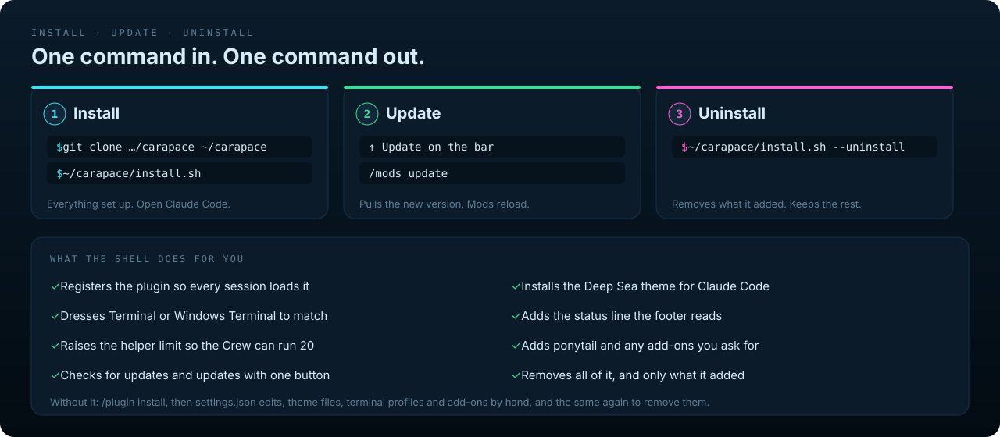

**macOS and Linux**

```sh
git clone https://github.com/dheerajponnaganti/carapace.git ~/carapace
~/carapace/install.sh
```

**Windows** (PowerShell)

```powershell
git clone https://github.com/dheerajponnaganti/carapace.git $HOME\carapace
powershell -ExecutionPolicy Bypass -File $HOME\carapace\install.ps1
```

Then open a new Claude Code session (restart one that is already open). That is all.

### Why a shell, and not a plugin you install by hand

A Claude Code plugin alone cannot set up everything carapace needs. Done by hand, you would run `/plugin install`, edit `settings.json` for the plugin folder, the theme, the status line and the helper limits, import the terminal colors, install each add-on, and later undo every one of those steps in the right order. The installer does all of it in one go, and keeps a record of what it changed:

- **Install:** one command sets up every mod, the matching Claude Code theme, the terminal look (Terminal on macOS, Windows Terminal on Windows), the status line the footer reads, room for 20 helpers at once, and ponytail. It only fills in what you have not set yourself.
- **Asks first:** before it changes the Terminal app's default look for every window, it asks. Say no and your windows stay as they are.
- **Says what ponytail is:** a third-party plugin that makes Claude write less code. `--no-ponytail` skips it.
- **Stops on an old Claude Code:** the installer exits with an error unless you add `--force`.
- **Update:** when there is a new version, **↑ Update** appears on the bar. The first press shows what is new; press again to install. Or type `/mods update`. No reinstall.
- **Uninstall:** `~/carapace/install.sh --uninstall` (or `install.ps1 -Uninstall`) removes everything it added and leaves the rest of your settings as they are. Add-ons you had before carapace are never touched.

Your `settings.json` is backed up before the first change (`settings.json.carapace-orig`) and written safely after that.

<details>
<summary><b>Installer options</b></summary>

| macOS and Linux | Windows | What it does |
| --- | --- | --- |
| `--no-terminal` | `-NoTerminal` | Leave the terminal's look alone |
| `--terminal` | `-Terminal` | Set up the Terminal app even when installing from another terminal |
| `--with rea,gstack,hookify,security-guidance,writing-rules` | `-With …` | Also add these [add-ons](#add-ons) (`all` means REA and gstack). `writing-rules` adds an example set of writing rules (no dashes, no filler words) for hookify to a folder; see [Add-ons](#add-ons) |
| `--folder <dir>` | `-Folder <dir>` | Where `writing-rules` writes its rules (the current folder by default) |
| `--no-ponytail` | `-NoPonytail` | Skip ponytail |
| `--force` | `-Force` | Install even when Claude Code is older than the minimum |
| `--remove <add-on>` | `-Remove <add-on>` | Remove one add-on that carapace added |
| `--manage <add-on>` | `-Manage <add-on>` | Let carapace own an add-on you had before, so uninstall removes it too |
| `--uninstall` | `-Uninstall` | Undo everything the install did |

</details>

**Needs:** Claude Code 2.1.299 or newer, git, and python3 (on macOS it comes with the Xcode command line tools).

On Linux the installer sets up everything except the terminal look, which is for the macOS Terminal and Windows Terminal.


## First run: a few questions

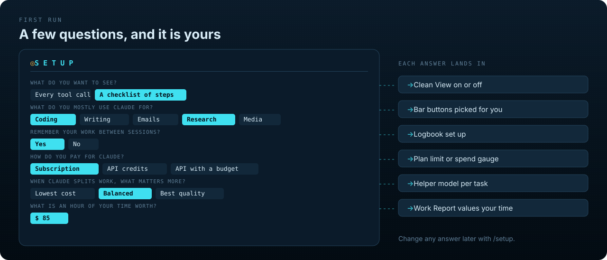

The first time you open a new Claude Code session after installing, carapace asks six questions. Each one changes something real:

1. **What do you want to see?** "Every tool call" shows everything Claude does. "A checklist of steps" shows plain-English steps instead.
2. **What do you mostly use Claude for?** Coding, writing, emails, research, images and media. This picks the buttons on your bar.
3. **Should Claude remember your work between sessions?** Yes sets up Logbook.
4. **How do you pay for Claude?** A subscription, API credits, or API credits with a budget. carapace detects which one you have and setup preselects it ("Detected: subscription."). You confirm it, and the budget lives here. The bar then shows your plan's limit, or your spend, or what is left of your budget.
5. **When Claude splits work across helpers, what matters more?** Lowest cost, balanced, or best quality. This picks the model the helpers run on.
6. **What is an hour of your time worth?** The Work Report values the time Claude saves you at this rate. Type a number, like 75.

Choose **Later** and setup does not count as done: it stops opening by itself, and **◎ Set up** stays on the bar until you save. `/setup` reopens the questions with your saved answers. If the window is too narrow, setup says so, and the bar's **◎ Set up** opens it.


## What you get

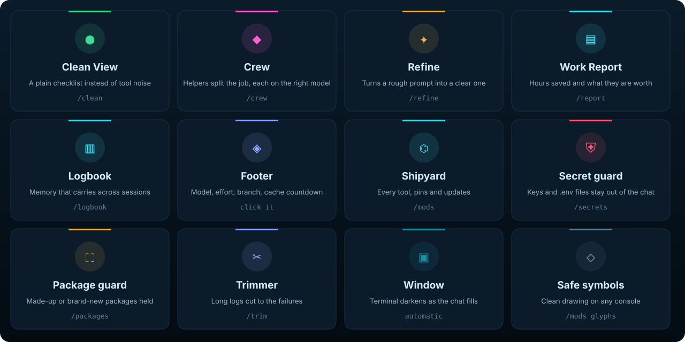

### See what Claude is doing

**● Clean View** replaces the scroll of tool calls with a checklist above the prompt. Each step has a plain-English name and its own progress bar, and the current one glows. Two gauges sit on the right. The first shows how much of your plan's 5-hour limit is left (**O₂**). The second shows how full the chat is (**▼ depth**), with a one-press **compact now** when it gets deep. The **Clean: on** / **Clean: off** button on the bar is a switch for the whole view. When Claude keeps hitting the same error, a red **stuck** row says so, with **Stop**. When a long job ends, your computer tells you. A job that ends early says so honestly: "Finished · 3 of 8 steps".


**◈ Footer** keeps the essentials under the prompt: the model and its effort, your git branch and how many files changed, and a countdown to when the prompt cache goes cold (after that, the next message costs more). It warns when your plan's limit will run out before it refills. Click the model to change the model or effort. The effort you pick is also saved as the default for new chats.

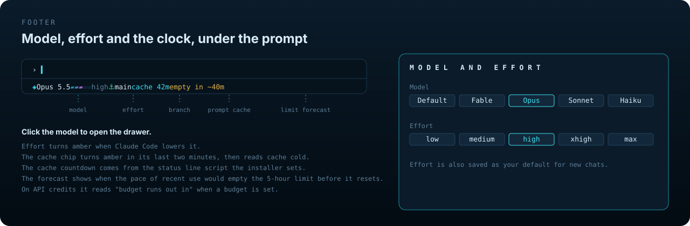

### Get more done

**◆ Crew** splits a big job across helper agents and shows them working. Each helper gets the cheapest model that fits its part: a quick lookup goes to Haiku, code to Sonnet, design and deep debugging to Opus (you can change the rules). The Crew badge on the bar counts helpers while they work. Pick a helper to watch its last actions, read its conversation, or send it a note. **Lanes** show the files each helper reads and writes, and warn when two write the same file.

The **done gate** keeps everyone honest: put your project's checks in `.carapace/done-checks` (one command per line, like `npm test`), and neither a helper nor Claude itself can say "done" while they fail. Claude is sent back twice to fix it, then it is over to you.


**✦ Refine** turns a rough prompt into a clear, complete one before it is sent. It asks a question or two when something is missing, marks what it added, and **Use it** puts the result in your prompt box. Turn on automatic mode to refine every prompt.

### Stay safe

**⛨ Secret guard** stops Claude from reading `.env` files, private keys and credential files, and masks any key or token that shows up in a command's output. `/secrets allow <path>` lets a single read through when you mean it.

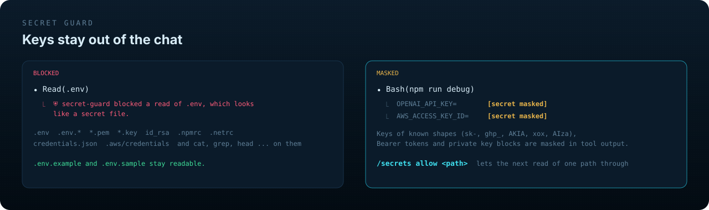

**⛶ Package guard** checks every package before `npm`, `pnpm`, `yarn`, `bun`, `pip`, `uv` or `poetry` installs it. A name that does not exist (a typo, or a package an AI made up), one published in the last 30 days, one almost nobody downloads, or a deprecated one is held, and Claude is told why. `/packages allow <name>` lets it through.

### Spend less

**✂ Trimmer** cuts long test, build and lint output down to the failures, a summary and a few lines around each error before Claude reads it. The full log is saved, and Claude gets its path. `/trim` shows the tokens saved.

**Your plan or your budget, always in view.** On a subscription, **O₂** is your plan's 5-hour limit with the time it refills. On API credits, the same spot shows tokens and spend, or what is left of a budget you set (`/budget $20 day`). carapace detects which kind of account you have, and setup asks you to confirm it.

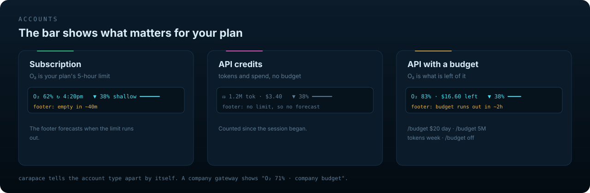

### Remember and measure

**▥ Logbook** gives Claude a memory that survives the end of a session. It keeps a folder of Markdown notes for your project (Obsidian is optional), in iCloud, Google Drive, OneDrive, Dropbox, on your computer, or a folder you already have. At the start of every session Claude reads its Home note and your open to-dos. When a job changes files or fetches pages, one line goes into the Build Log under today's date. Your own notes are never touched.

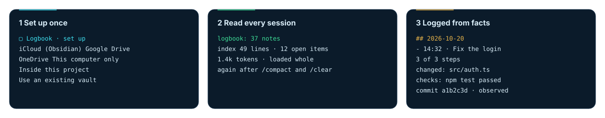

**▤ Work Report** counts what Claude finished for you, by day, week, month and year, sorted into code, documents, emails, images and video, research and other. Each kind has its own "minutes saved per task", and the total is valued at your hourly rate. Hours and value are estimates. A quick chat or a one-line fix does not count as a full task, and a small code change counts as Other, not Code. A weekly card sums it up.

It also keeps a **Timeline**: a hidden snapshot after every edit, so you can restore any earlier state. It works in git projects. Snapshots live in `~/.claude/carapace/snapshots`, outside your project. `/report snapshots off` stops them. When a check that used to pass starts failing, Claude is told what changed since then and where to look, and the Timeline offers the last good snapshot. A check that fails with no file changed is marked **flaky**.

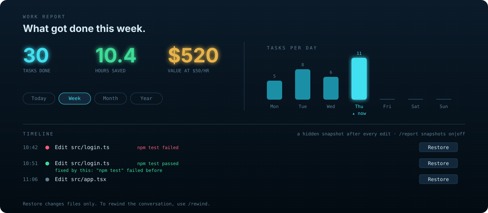

### Make it yours

**⌬ Shipyard** (`/mods`) is the control room: every tool with its state, one key each. Pin up to five on the bar (Crew, Refine, Clean, Logbook and Report by default). It also holds updates, add-ons, and the problem report. Keys: `c` Crew, `r` Refine, `w` Work Report, `v` Clean View, `l` Logbook, `m` Motion, `s` Setup, `u` Update, `p` Repeated prompts. It notices prompts you keep retyping and turns one into a slash command.

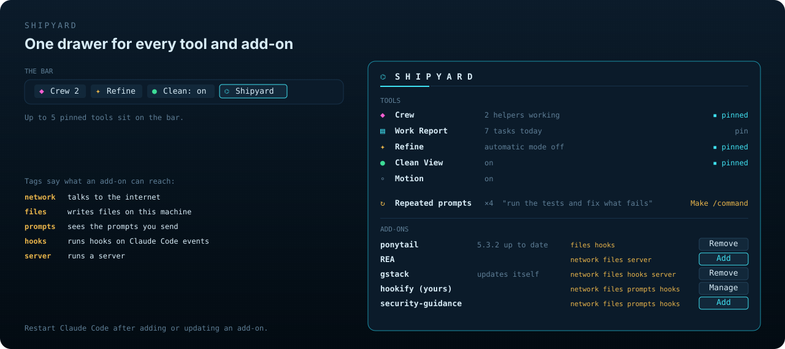

**Deep Sea** is the look carapace ships with. Cyan and magenta on deep water. A tide rises as the chat fills, bubbles drift up while Claude works, and the Crew shows on sonar. Its words follow the sea too: Crew, Shipyard, Logbook, O₂.


**New themes coming soon.**

**▣ Window** (macOS Terminal): the window's background darkens as the chat fills, a quiet hint that it is time to compact.

**◇ Safe symbols** swaps box lines and shapes for plain characters on consoles that draw them too wide (the old Windows console, some Asian-language setups). It turns on by itself where it is needed.


## Commands

The buttons on the bar cover most of this. These are for when you prefer typing.

| Command | What it does |
| --- | --- |
| `/setup` | Answer the setup questions again |
| `/mods` | Open the Shipyard |
| `/mods pin <tool>` · `/mods unpin <tool>` | Put a tool on the bar (up to five) or take it off |
| `/mods update` | Install the new version when ↑ Update shows |
| `/mods problem` | Report a problem (you see exactly what is sent first) |
| `/crew` · `/crew 5` | Open the Crew · set how many helpers can run at once |
| `/crew rules` | See or change which model each kind of helper gets |
| `/refine` · `/refine <prompt>` | Refine a prompt |
| `/report` · `/report settings` | Open the Work Report · see or change the hourly rate and minutes per task |
| `/logbook` | Set up or open Logbook |
| `/clean on` · `/clean off` | The checklist, or every tool call |
| `/budget $20 day` · `/budget off` · `/budget` | API credits only: set or clear a budget (per session, day, week or month), or see its status |
| `/secrets` · `/packages` · `/trim` | Status of each guard, and `on`, `off` or `allow` |

<details>
<summary><b>Every option</b></summary>

| Command | What it does |
| --- | --- |
| `/mods check` | Check for an update now (it checks by itself at most every 6 hours) |
| `/mods more on\|off` | Show other plugins' rows above the prompt behind ⋯ More, or hide them (the default) |
| `/mods glyphs on\|off\|auto` | Plain one-cell symbols for consoles that draw shapes two cells wide |
| `/crew rules code opus` | Give one kind of helper a different model |
| `/report settings rate 75` · `/report settings code 45` | Your hourly rate · minutes saved per task of one kind |
| `/report snapshots on\|off` | The edit Timeline's snapshots |
| `/logbook on\|off` · `/logbook use <folder>` | Stop or start reading and logging · use an existing vault for this folder |
| `/clean bubbles on\|off` · `/clean notify on\|off` | The bar's motion · the notice when a long job ends |
| `/budget 5M tokens week` | A budget in tokens instead of dollars |
| `/secrets allow <path>` | Let one read of a secret file through |
| `/packages allow <name>` | Let a held package through for this session |
| `/trim skip <word>` | Never trim a command containing this word (or add `# no-trim` to one command) |

</details>


## Add-ons

The Shipyard's Add-ons section adds other people's tools with one press, and removes them as cleanly. Small tags on each row say what it can reach (network, files, prompts, hooks). Restart Claude Code after adding one.

| Add-on | What it does | |
| --- | --- | --- |
| [ponytail](https://github.com/DietrichGebert/ponytail) | Makes Claude write less code and use fewer tokens | Installed by default |
| [gstack](https://github.com/garrytan/gstack) | A large set of skills for planning, review, QA and shipping | Needs git and [Bun](https://bun.sh) |
| [REA](https://github.com/morluto/rea) | Lets Claude inspect apps and compiled programs without their source | Needs Node and npm |
| [hookify](https://github.com/anthropics/claude-plugins-official/tree/main/plugins/hookify) | Checks every write against rules you set. carapace adds none by itself | From Anthropic |
| writing-rules | An example set of writing rules for hookify (no dashes, no filler words), written into the folder you give or the current one (`--with writing-rules`). Edit them to make them yours. | From carapace, opt-in |
| [security-guidance](https://github.com/anthropics/claude-plugins-official/tree/main/plugins/security-guidance) | Warns about risky code as it is written | From Anthropic |

An add-on you had before carapace shows "(yours)" and is never removed, unless you press **Manage** to hand it to carapace.


## What stays on your computer

Everything, except these:

- **Update check:** at most every 6 hours, carapace asks GitHub whether there is a new version, and checks the versions of add-ons it installed.
- **Package guard:** the name of a package about to be installed goes to the npm or PyPI registry, the same place the install itself would ask.
- **Refine and job names:** go to Claude through your own Claude Code account, like any message you send.
- **Timeline:** snapshots stay in `~/.claude/carapace/snapshots` on your computer. `/report snapshots off` stops them.
- **Logbook:** writes only to the folder you chose. If that is a cloud folder, your cloud service syncs it.

carapace keeps a small error log at `~/.claude/carapace/log.txt`: errors only, never your prompts, replies or files. When something breaks, **⚑ Problem** appears on the bar. It shows exactly what would be sent, and sends nothing until you choose **Open on GitHub** or **Save to file**.


## Questions

<details>
<summary><b>Does carapace change Claude's answers?</b></summary>

The model is the same; a few things it sees change, each on purpose. Claude is told the person sees a checklist of its steps instead of tool calls. Before a plan, it may only look things up (reads and searches). Edits and commands wait for the plan. Logbook adds your project's Home note at the start of a session, the Trimmer shortens long logs, the Secret guard masks keys, and the Crew tells Claude which model each helper should use. The guards can hold a file read or a package install, and the done gate can send Claude back when your checks fail. Each of these has an off switch.
</details>

<details>
<summary><b>Does it cost extra tokens?</b></summary>

A little, for the checklist: Claude names its steps and reports progress, a few short tool calls per job. Clean View also asks Claude for a short job title, one small extra call per job. Turn it off with `/clean off`. In return, the Trimmer cuts long logs, the Crew runs small tasks on cheaper models, and ponytail keeps code short. In headless runs (`claude -p`, CI) the checklist is off, since nobody sees it.
</details>

<details>
<summary><b>I don't want something. Can I turn it off?</b></summary>

Yes. Every mod has an off switch, in its command or in the Shipyard, and unpinned tools stay out of the bar.
</details>

<details>
<summary><b>Will it mess up my Claude Code settings?</b></summary>

It only adds what you have not set yourself and never replaces your own theme or status line. It backs `settings.json` up before the first change, and `--uninstall` takes out exactly what it added.
</details>

<details>
<summary><b>Can I install it with <code>/plugin install</code> instead?</b></summary>

Yes, inside Claude Code: `/plugin install carapace --marketplace dheerajponnaganti/carapace`. You get the mods, but not the theme, the terminal look, the status line, the helper limit, the add-ons or the one-button update and uninstall. The installer is the easy way.
</details>


## Contributing

Bug reports and fixes are welcome. [CONTRIBUTING.md](CONTRIBUTING.md) explains the checks and the branch flow; pull requests go into `dev`. Security problems: see [SECURITY.md](SECURITY.md). What changed in each release: [CHANGELOG.md](CHANGELOG.md).


## Credits

carapace installs other people's work without copying it: each add-on comes from its own source, with its own license and authors.

| Project | By | License |
| --- | --- | --- |
| [ponytail](https://github.com/DietrichGebert/ponytail) | DietrichGebert | MIT |
| [gstack](https://github.com/garrytan/gstack) | Garry Tan | MIT |
| [REA](https://github.com/morluto/rea) | morluto | MIT |
| [hookify](https://github.com/anthropics/claude-plugins-official/tree/main/plugins/hookify), [security-guidance](https://github.com/anthropics/claude-plugins-official/tree/main/plugins/security-guidance) | Anthropic | Apache-2.0 |

Ideas came from [claude-hud](https://github.com/jarrodwatts/claude-hud) by Jarrod Watts, [ccstatusline](https://github.com/sirmalloc/ccstatusline) by sirmalloc, [claude-powerline](https://github.com/Owloops/claude-powerline) by Owloops, [CCometixLine](https://github.com/Haleclipse/CCometixLine) by Haleclipse, and several mod ideas from [tristenobrien.ai](https://tristenobrien.ai). Thank you to all of them.

<div align="center"><sub>MIT © Dheeraj Ponnaganti</sub></div>
